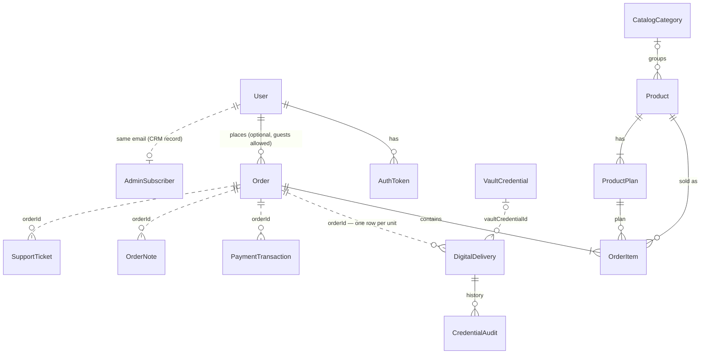

# Database

Prisma schema: [`prisma/schema.prisma`](../../prisma/schema.prisma). SQLite today, PostgreSQL later (ADR-006).

```env
DATABASE_URL="file:./dev.db"
```

```bash
npx prisma db push      # apply schema to the dev DB
npx prisma generate     # regenerate the client
```

Helper scripts (run with `npx tsx`):

- `scripts/ensure-admin.ts` — create or fix the first admin user
- `scripts/backfill-warranty-dates.ts` — fill warranty start/end on old deliveries (safe to re-run)
- `scripts/clear-db.ts` — wipe tables (`bun run db:clear`)

## ERD

Solid lines are real foreign keys. Dotted lines are links by id/email that the app keeps in step
(kept loose on purpose: fulfillment rows must survive catalog or account changes).



## Tables

| Table | What it holds |
|-------|---------------|
| **User** | Login accounts. `role` CUSTOMER / STAFF / ADMIN, `permissionsJson` for staff, `passwordHash` (bcrypt), `emailVerifiedAt`, `sessionVersion` (bump = sign out everywhere). |
| **AuthToken** | One-time links: `verify_email` (24 h) and `reset_password` (1 h). Only a SHA-256 hash of the token is stored; `usedAt` marks it spent. |
| **CatalogCategory / WarrantyTemplate / CredentialScheme** | Catalog taxonomies used by the product editor. |
| **Product** | Catalog item. `status` active / out_of_stock / suspended / draft, `renewable`, `allowOrderWhenOutOfStock`, optional order window `availableFrom` / `availableUntil` (UTC; before/after it new orders are refused, renewals are not). |
| **HomeBanner** | Homepage hero images: `slot` main (max 5) / side (max 2), `position`, `imageUrl`, `width`/`height`, `alt`, `linkType` none / product / category / url + `linkValue`, `isActive`. When no row exists the storefront shows its built-in defaults. |
| **ProductPlan** | Sellable option: price, duration, warranty days, delivery mode. |
| **Order** | Checkout or admin-created order. `totalBdt`, `paidBdt`, `paymentStatus` unpaid / partial / paid, `source` storefront / admin, `accessToken` (guest proof). |
| **OrderItem** | Order lines (product + plan + quantity + price). |
| **OrderNote** | Internal notes. Editable/deletable for 24 h, then locked. |
| **VaultCredential** | Credential stock. Secrets encrypted with AES-256-GCM. |
| **DigitalDelivery** | One row per purchased unit: status, linked vault credential, chat, access end (`orderExpiresAt`), warranty clock (`warrantyStartsAt/EndsAt`, queued `nextWarranty*` for early renewals). |
| **CredentialAudit** | Assign / replace / renew history per delivery. |
| **SupportTicket** | Buyer support threads (messages as JSON). |
| **AdminNotification** | Admin inbox items. |
| **AdminSubscriber** | Admin CRM view of a customer (tier, status, totals). `status = suspended` blocks that customer's login. |
| **PaymentTransaction** | Payments: `kind` purchase / renewal / manual, `status` verified / pending_verification / refunded / rejected. `renewDeliveryIds` lists the units a renewal extends; `periodFrom`/`periodTo` record the access period it paid for and `verifiedAtLabel` when it was verified (set on verify; older renewals have none and the order page works the period out from the end date). |
| **CouponCode** | Discount codes. |
| **StoreSetting** | Key/value settings: `storeSettings` (maintenance, pause orders, announcement, renew window) and `emailConfig` (provider + encrypted secrets). |
| **MediaAsset** | Media library. |

Removed as unused: `DigitalDelivery.payloadJson`, `Product.totalSales`, `Product.monthlyRevenueBdt`.

## Rules

- Money on catalog/orders: `Decimal` (`priceBdt`, `totalBdt`, `paidBdt`). Payment rows store whole taka (`Int`).
- Enums are `String` + app constants, so the schema stays portable to Postgres.
- Secrets (vault passwords, SMTP password, email API keys) are encrypted at rest (`lib/crypto/secrets.ts`).
  The key comes from `ENCRYPTION_KEY`, or `AUTH_SECRET` if unset — changing it makes saved secrets unreadable.
- Passwords are never stored or shown in plain text. Admins can only set a new one.

## PostgreSQL cutover (later)

1. Set `provider = "postgresql"` in the schema and a Postgres `DATABASE_URL`.
2. Start a fresh migration history (`prisma migrate dev --name init_postgres`); don't replay SQLite SQL.
3. Move data across, then run `scripts/backfill-warranty-dates.ts` once.
4. Move the in-memory rate limiter (`lib/auth/rate-limit.ts`) to the DB or Redis if you run more than one server.
