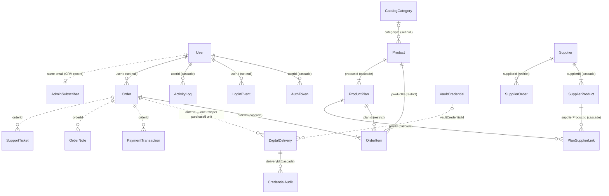

# Database Specification

Prisma schema: [`prisma/schema.prisma`](../../prisma/schema.prisma). SQLite today, PostgreSQL-ready architecture (ADR-006).

```env
DATABASE_URL="file:./dev.db"
```

```bash
npx prisma db push      # apply schema to the dev DB
npx prisma generate     # regenerate the Prisma client
```

Helper scripts (run with `npx tsx`):

- `scripts/ensure-admin.ts` — creates or recovers the initial superadmin account
- `scripts/backfill-warranty-dates.ts` — backfills warranty start/end timestamps on legacy deliveries
- `scripts/clear-db.ts` — wipes tables for clean local dev (`npm run db:clear`)
- `scripts/test-security-basics.ts` — tests token generation and secret encryption (`npm run test:security`)

---

## Entity-Relationship Diagram (ERD)

Solid lines (`||--o{`) represent enforced relational foreign keys with cascade/restrict rules.
Dotted lines (`||..o{`) represent loose domain links by ID or email designed to keep fulfillment and payment records resilient to catalog modifications or account deletion.



---

## Tables & Schema Reference

### 1. User, Identity & Staff Security
| Model | Details |
|---|---|
| **User** | Store accounts and operator logins. Fields: `id`, `email` (unique), `name`, `phone`, `role` (`CUSTOMER` \| `STAFF` \| `ADMIN`), `permissionsJson` (array of `StaffPermissionKey` strings), `passwordHash` (bcrypt), `emailVerifiedAt`, `sessionVersion` (`Int @default(0)` — incremented to invalidate older JWT sessions across all devices). Index: `@@index([role])`. |
| **LoginEvent** | Audit record of every login attempt. Fields: `userId`, `email`, `method` (`password`), `success`, `ip`, `userAgent`, `createdAt`. Indexes: `@@index([userId, createdAt])`, `@@index([email, createdAt])`. |
| **ActivityLog** | Comprehensive staff and admin audit trail for accountability. Fields: `userId` (FK to `User`), `action`, `entityType`, `entityId`, `summary`, `ip`, `createdAt`. Indexes: `@@index([userId, createdAt])`, `@@index([entityType, entityId])`. |
| **AuthToken** | One-time authentication tokens for `verify_email` (24 h) and `reset_password` (1 h). Stores `tokenHash` (SHA-256 hash), `expiresAt`, `usedAt`. Index: `@@index([userId, type])`. |
| **AdminSubscriber** | CRM view of customers with cumulative metrics: `ordersCount`, `totalSpentBdt`, `warrantyClaimsCount`, `role` (`subscriber`, `reseller`, `vip`), and `status` (`active`, `past_due`, `suspended` — suspended status immediately halts storefront access). |

### 2. Catalog & Inventory
| Model | Details |
|---|---|
| **CatalogCategory** | Taxonomy categorization (`AI`, `STREAM`, `WORK`, `CREATE`). |
| **Product** | Catalog entity: `slug` (unique), `name`, `description`, `tagline`, `category`, `status` (`active` \| `draft`), `featured`, `sale`, `imageUrl`, `galleryJson`. Indexes: `@@index([categoryId])`, `@@index([status])`. |
| **ProductPlan** | Sellable subscription options. Sourcing fields: `sourcing` (`own`, `own_then_supplier`, `supplier_auto`, `supplier_manual`), `pricingMode` (`fixed`, `auto`), `markupPercent`, `markupFlatBdt`, `roundToBdt`, `minMarginBdt`, `renewalPricing` (`current`, `locked`), `allowBackorder`, `availableFrom`, `availableUntil` (order window), `pricingAlert`. Constraint: `@@unique([productId, code])`. |
| **VaultCredential** | Encrypted credential vault (`secretValue`, `password`, `email`, `profilePin` stored with AES-256-GCM encryption). Statuses: `available`, `delivered`, `replaced`, `expired`. Indexes: `@@index([productId, variantId])`, `@@index([status])`, `@@index([expiresAt])`. |
| **HomeBanner** | Storefront hero slides (`main`, `side`), responsive dimensions, and navigation link bindings (`product`, `category`, `url`). Index: `@@index([slot, position])`. |
| **WarrantyTemplate** & **CredentialScheme** | Standardized warranty definitions and structured credential input form schemas. |

### 3. Orders, Payments & Fulfillment
| Model | Details |
|---|---|
| **Order** | Orders created via storefront or admin. `status` (`PENDING`, `COMPLETED`, `CANCELLED`), `totalBdt`, `paidBdt`, `paymentStatus` (`unpaid`, `partial`, `paid`), `source` (`storefront`, `admin`), `accessToken` (unguessable guest token). Indexes: `@@index([userId])`, `@@index([status])`, `@@index([accessToken])`. |
| **OrderItem** | Order line items with historical snapshot of `unitPriceBdt` and `qty`. Indexes: `@@index([orderId])`, `@@index([productId])`, `@@index([planId])`. |
| **PaymentTransaction** | Customer payments and refunds. Fields: `orderId`, `buyerName`, `buyerEmail`, `amountBdt`, `gateway` (`bKash`, `Nagad`, `Rocket`, etc.), `senderNumberOrRef`, `trxId`, `status` (`verified`, `pending_verification`, `refunded`, `rejected`), `kind` (`purchase`, `renewal`, `manual`), `renewDeliveryIds`, `periodFrom`, `periodTo`, `verifiedAtLabel`. Critical Indexes: `@@index([trxId])` (enforces sub-millisecond anti-replay validation), `@@index([status])`, `@@index([orderId])`, `@@index([deliveryId])`. |
| **DigitalDelivery** | Unit-level fulfillment record (1 row per quantity purchased). Fields: `orderId`, `status` (`delivered`, `pending_dispatch`, `warranty_claim`, `replaced`, `revoked`), `vaultCredentialId`, `orderExpiresAt`, `warrantyStartsAt`, `warrantyEndsAt`, `nextWarrantyStartsAt`, `nextWarrantyEndsAt`, `supplierState` (`''`, `processing`, `delivered`, `needs_review`, `failed`), `supplierRev` (optimistic concurrency version counter). Indexes: `@@index([status])`, `@@index([orderId])`, `@@index([vaultCredentialId])`, `@@index([renewalPending])`. |
| **CredentialAudit** | Immutable append-only audit trail for credential disclosures, replacements, and revocations per unit. Indexes: `@@index([deliveryId, createdAt])`, `@@index([vaultCredentialId])`. |
| **OrderNote** | Internal operator notes on orders/units. Editable and deletable for 24 hours from creation, after which entries lock into immutable audit history. Index: `@@index([orderId, createdAt])`. |
| **SupportTicket** | Integrated customer service threads. Index: `@@index([status])`. |
| **AdminNotification** | Administrative alerts (e.g. new orders, renewal payments, low balance). Index: `@@index([read])`. |
| **CouponCode** | Promotional discounts with expiration dates and usage count limits. |
| **StoreSetting** | Key-value application configuration store (`storeSettings`, `emailConfig`). |
| **MediaAsset** | Media file metadata for uploaded product images and banners. |

### 4. Supplier Reseller Integration Models
| Model | Details |
|---|---|
| **Supplier** | Reseller API configuration (`pandora`, `jaha`, `mock`). Holds `baseUrl`, encrypted API keys (`apiKeyEnc`), `currency` (`USD`, `USDT`), `isEnabled`, `purchasingEnabled` (kill switch), `balance`, `syncIntervalMin`, `lowBalanceAlert`. |
| **SupplierProduct** | Synced catalog items from external suppliers. Tracks `externalId`, `price`, `currency`, `stock`, `status` (`available`, `out_of_stock`, `removed`), `deliveryType` (`instant`, `automatic`, `manual`), and `previousPrice`. Unique: `@@unique([supplierId, externalId])`. |
| **PlanSupplierLink** | Maps a local `ProductPlan` to one or more `SupplierProduct` options with explicit `priority` (fallback chain). Unique: `@@unique([planId, supplierProductId])`. |
| **SupplierOrder** | Idempotent purchase log per customer delivery unit. `id` serves as the `Idempotency-Key` sent to external suppliers (`so_<timestamp><random>`). Contains `costBdt`, `salePriceBdt`, `requestJson` (payload for identical retries), `resultEnc` (AES-256-GCM encrypted supplier response), and `status` (`queued`, `processing`, `delivered`, `failed`, `needs_review`). Indexes: `@@index([status])`, `@@index([orderId])`, `@@index([deliveryId])`. |
| **PriceHistory** | Audit trail recording every pricing adjustment: old value, new value, source (`admin`, `auto`, `supplier`, `rate`, `system`), actor, and timestamp. Index: `@@index([productId, createdAt])`. |
| **CurrencyRate** | Real-time exchange rate table for foreign supplier currencies (e.g. USD $\rightarrow$ BDT). |
| **SupplierWebhookEvent** | Idempotency log of received webhook event IDs to prevent replay. |

---

## Architectural Rules

1. **Monetary Precision**:
   - Catalog and order calculations utilize Prisma `Decimal` (`priceBdt`, `totalBdt`, `paidBdt`) to prevent floating-point inaccuracies.
   - Payment transaction amounts are recorded as integer Taka (`Int`).
2. **Schema Portability**:
   - Statuses and types are modeled as `String` backed by strict TypeScript union types and constants, guaranteeing seamless portability when migrating from SQLite to PostgreSQL.
3. **Secret Encryption**:
   - Credentials, supplier API keys, webhook secrets, and SMTP credentials are encrypted at rest using AES-256-GCM via [`lib/crypto/secrets.ts`](file:///d:/Project/BitLogic/lib/crypto/secrets.ts).
   - Encrypted strings are prefixed with `enc:v1:` to enable transparent key rotation.
4. **Idempotency & Replay Prevention**:
   - Payments indexed via `@@index([trxId])` enable immediate uniqueness validation in checkout and renewal transactions.
   - External supplier orders utilize stable IDs as HTTP idempotency keys.
