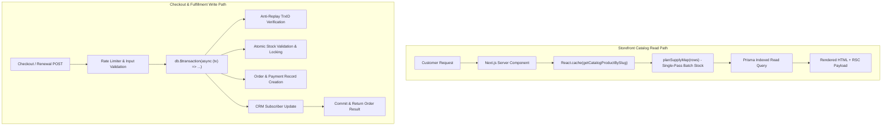

# BitLogic — System Specification & Architecture

## Stack

- **Framework**: Next.js 15 (App Router), React 19, TypeScript
- **Styling**: Tailwind CSS v4 (`@tailwindcss/postcss`)
- **Package Manager**: Bun / NPM / PNPM compatible (`package.json`, `bun.lock` / `package-lock.json`)
- **ORM & Database**: Prisma ORM with SQLite for local development (`DATABASE_URL="file:./dev.db"`), designed for seamless PostgreSQL cutover (see [ADR-006](../adr/ADR-006-prisma-sqlite-postgres-path.md))
- **Cryptography & Security**: Native `node:crypto` AES-256-GCM for encrypted secrets; `jose` for HS256 JWT session tokens; `bcryptjs` for password hashing

---

## Surfaces

| Surface | Base URL | Implementation | Description |
|---|---|---|---|
| **Storefront** | `/` | `app/(store)/` + `components/storefront/` | Buyer shopping, instant order, cart, checkout, content pages, and customer account dashboard (`/account`). |
| **Admin Console** | `/admin` | `app/admin/` + `components/admin/` | Complete operational backend for products, vault inventory, orders, deliveries, payments, suppliers, and settings. |

Buyer account is unified inside the storefront at `/account` rather than being an isolated third portal (see [ADR-005](../adr/ADR-005-no-separate-user-portal.md)).

---

## Routes

### Storefront Routes (`app/(store)/`)
| Path | Route Type | Purpose |
|---|---|---|
| `/` | Server Component | Homepage featuring dynamic hero banners, category filters, and curated product sections. |
| `/shop` | Server Component | Searchable and filterable catalog grid (`?code=`, `?q=`). |
| `/product/[id]` | Server Component | Comprehensive product detail view with live order-window countdown, plan selection, and rich SEO JSON-LD structured data. |
| `/cart` | Client Component | Cart management, coupon validation, customer details input, and bKash/Nagad checkout submission. |
| `/login` | Client Component | Authentication portal: customer sign-in, registration (`?mode=register`), and forgot-password initiation. |
| `/reset-password` | Client Component | Secure token-based password reset completion (`?token=`). |
| `/account/[[...section]]`| Client Component | Unified buyer dashboard (`orders`, `warranties`, `tickets`, `profile`, `security`). |
| `/how`, `/faq`, `/contact` | Server Component | Informational and trust-building support pages. |

### Admin Console Routes (`app/admin/`)
Catch-all route `app/admin/[[...slug]]/page.tsx` maps views via [`lib/admin-routes.ts`](file:///d:/Project/BitLogic/lib/admin-routes.ts):
- `/admin` — Overview Dashboard with revenue metrics, real-time counters, and recent activity
- `/admin/products` — Catalog management, pricing rules, plan options, and order windows
- `/admin/vault` — Credential stock management, batch import, and AES-256-GCM encryption
- `/admin/deliveries` — Unit-level fulfillment, credential assignments, warranties, notes, and chat
- `/admin/payments` — Payment verification, TrxID validation, rejection, and refund handling
- `/admin/suppliers` — Reseller API connections, catalog sync, pricing rules, and purchase logs
- `/admin/customers` — Customer CRM records, tier management, and security suspensions
- `/admin/staff` — Staff account creation, role assignment, and granular menu permissions
- `/admin/settings` — Store maintenance, order pause, announcement bar, and email configuration

---

## Caching & Data Flow Architecture

BitLogic implements a clean, bifurcated architecture separating read-heavy storefront catalog operations from high-integrity financial transactions:

### 1. Storefront Catalog Read Path
- **Zero-Latency In-Memory Memoization**: Product queries in [`lib/catalog/queries.ts`](file:///d:/Project/BitLogic/lib/catalog/queries.ts) utilize React's per-request `cache()` wrapper for deduplication across metadata generation and page rendering.
- **Single-Pass Batch Stock Resolution**: The catalog engine fetches both internal vault stock and external supplier stock through a single bulk aggregation (`planSupplyMap`), entirely eliminating N+1 database queries.
- **Index-Accelerated Lookups**: Reads on `Product` and `ProductPlan` target indexed status fields (`@@index([status])`, `@@index([categoryId])`).

### 2. Checkout & Order Write Path (Direct DB Transactions)
- **ACID Transaction Isolation**: All state mutations during checkout and renewals run through `db.$transaction` in [`lib/orders/create-order.ts`](file:///d:/Project/BitLogic/lib/orders/create-order.ts).
- **Zero-Stale-Read Guarantee**: Checkout explicitly **bypasses any read caches**, reading fresh inventory and plan state directly from the database transaction client.
- **Atomic Operations Inside the Transaction**:
  1. Validates store maintenance and order paused switches (`getStoreSettings`).
  2. Enforces TrxID anti-replay protection by querying `tx.paymentTransaction.findFirst({ where: { trxId } })`.
  3. Validates order window schedules and option availability.
  4. Validates coupon constraints and atomically increments `usedCount`.
  5. Creates `Order`, `OrderItem`, and `PaymentTransaction` records.
  6. Automatically updates or registers the buyer in `AdminSubscriber`.

---

## Loading States & Zero-CLS Skeletons

To provide a seamless, native-feeling user experience and prevent Cumulative Layout Shift (CLS), BitLogic employs explicit React Suspense boundaries paired with structured layout skeletons across both surfaces:

### 1. Storefront Skeletons
Implemented in [`components/storefront/ui/StorefrontSkeletons.tsx`](file:///d:/Project/BitLogic/components/storefront/ui/StorefrontSkeletons.tsx):
- `StorefrontHeroSkeleton`: Replicates the exact proportions of the homepage hero banner carousel.
- `ProductGridSkeleton`: Pre-allocates space for responsive 2-column to 4-column product cards.
- `ProductDetailSkeleton`: Replicates the two-column product detail layout (image showcase on the left, plan selector and pricing card on the right).
- `CartPageSkeleton`: Matches the cart line-item layout and checkout drawer.
- `AccountPageSkeleton`: Matches the tabbed account management view.

### 2. Route Loading Boundaries
Next.js `loading.tsx` files automatically mount these skeletons during asynchronous server transitions:
- `app/(store)/loading.tsx` — Root storefront fallback
- `app/(store)/shop/loading.tsx` — Catalog grid fallback
- `app/(store)/product/[id]/loading.tsx` — Product page fallback
- `app/(store)/cart/loading.tsx` — Cart checkout fallback
- `app/(store)/account/[[...section]]/loading.tsx` — Account view fallback
- `app/admin/loading.tsx` — Admin console loading skeleton ([`components/admin/ui/AdminSkeleton.tsx`](file:///d:/Project/BitLogic/components/admin/ui/AdminSkeleton.tsx))

---

## Security Architecture

1. **Role-Based Authentication**:
   - HTTP-only cookie session (`bitlogic_session`) containing an encrypted HS256 JWT signed via `jose`.
   - `User.sessionVersion` checked on database resolution to invalidate sessions on password reset or account suspension.
2. **Rate Limiting**:
   - Sliding-window in-memory rate limiting applied to login, registration, order creation, and supplier dispatch routes.
3. **Secret Encryption**:
   - All sensitive credentials and third-party API keys are encrypted at rest with AES-256-GCM (`lib/crypto/secrets.ts`).
4. **Input Boundaries**:
   - Strict 11-digit Bangladeshi telephone format validation.
   - 100k+ domain disposable email blocking.
   - Payment gateway whitelisting and transaction ID replay prevention.
